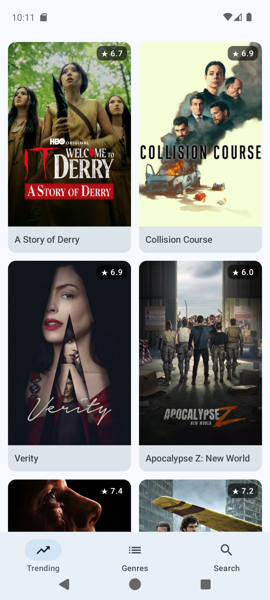
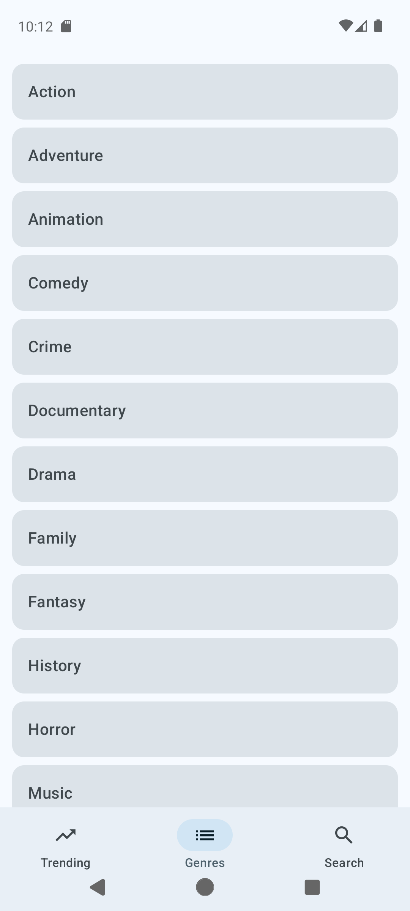
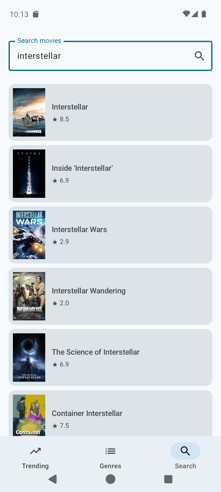

# The Movies

An Android application that reads The Movie Database over its REST API and
shows what is trending, the full genre list and a live search — built entirely
in Jetpack Compose over four assignments during an Android traineeship at
nWeave, where every feature was delivered as a pull request and revised in code
review before it was merged.

**24 Kotlin files · ~900 lines · 4 pull requests, each reviewed.**

## Screenshots

| Trending | Genres | Search | Empty search |
| --- | --- | --- | --- |
|  |  |  |  |

## What it does

- Opens on a splash screen that carries the app icon on the TMDB navy
- **Trending** — the day's trending films as a two-column poster grid, with
  each film's rating laid over its poster
- **Genres** — the official TMDB genre list
- **Search** — type a title and the matching films come back in a list, each
  with its poster, year and rating
- Three tabs along the bottom, each keeping its own back stack

## Architecture

MVVM. Each screen owns a ViewModel, and the ViewModel exposes one observable
state rather than several flags that could disagree with each other.

```
data/
├── model/      Movie, Genre, and the two response envelopes
└── remote/     TmdbApi — one Retrofit interface, three endpoints

di/
└── NetworkModule   Hilt assembles the interceptors, the client,
                    the JSON converter and the API as singletons

ui/
├── navigation/ the three destinations and the NavHost
├── trending/   screen + state + ViewModel
├── genres/     screen + state + ViewModel
├── search/     screen + state + ViewModel
├── components/ MovieCard, shared across screens
└── theme/      colours, typography, Material theme
```

## Decisions worth pointing at

### A screen's state is a closed set of cases

Each screen holds its state as a `sealed interface`, so loading, failure and
result cannot be true at the same time:

```kotlin
sealed interface SearchState {
    object Empty : SearchState
    object Loading : SearchState
    data class Success(val movies: List<Movie>) : SearchState
    data class Error(val message: String) : SearchState
}
```

The screen reads it with a `when`, and the compiler refuses the code until
every case is handled. Search has a fourth case the other two do not: an empty
field is not an error and not a result, so it gets a state of its own rather
than being faked with an empty list.

### The API key is attached by an interceptor, not by the call sites

`TmdbApi` declares no `api_key` parameter. An OkHttp interceptor adds it to
every request on the way out:

```kotlin
val url = chain.request().url.newBuilder()
    .addQueryParameter("api_key", BuildConfig.TMDB_API_KEY)
    .build()
```

No call site has to remember it, and a new endpoint is authenticated the moment
it is written.

### Traffic is logged in debug builds only

The logging interceptor runs at `BODY` level while debugging and at `NONE`
otherwise. The URL carries the key, and that has no business in a released
app's logs.

### One envelope, named for what it holds

Trending and search return the same shape — a page of films. Rather than a
`TrendingResponse` and a `SearchResponse` with identical fields, there is one
`MovieListResponse`, named for what it holds rather than for the first call
that used it.

### Search is a GET

The assignment brief asked for search to be a POST. TMDB's documentation says
`/search/movie` is a GET, and a POST to it answers `405 Method Not Allowed` —
searching only reads, so it is a GET. The brief was raised with the mentor
rather than worked around.

## Running it

The API key is never committed. Add your own TMDB key to `local.properties`,
which is git-ignored:

```properties
tmdbApiKey=your_key_here
```

Gradle reads it at build time and exposes it as `BuildConfig.TMDB_API_KEY`, so
it reaches the interceptor without ever appearing in a source file.

## Built with

Kotlin · Jetpack Compose · Navigation Compose · Material 3 · MVVM · Hilt ·
Retrofit · OkHttp · Gson · Glide · Coroutines · StateFlow
